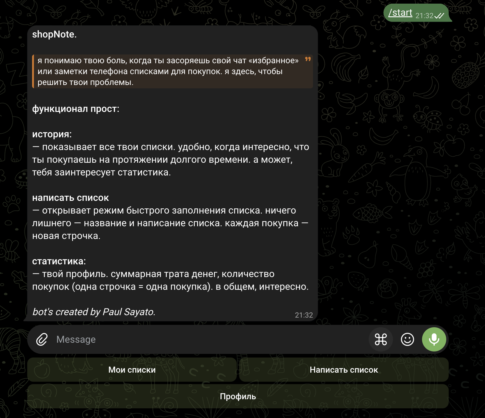
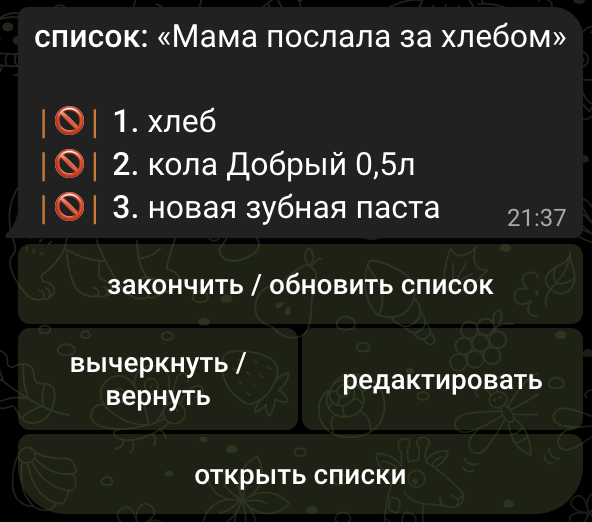
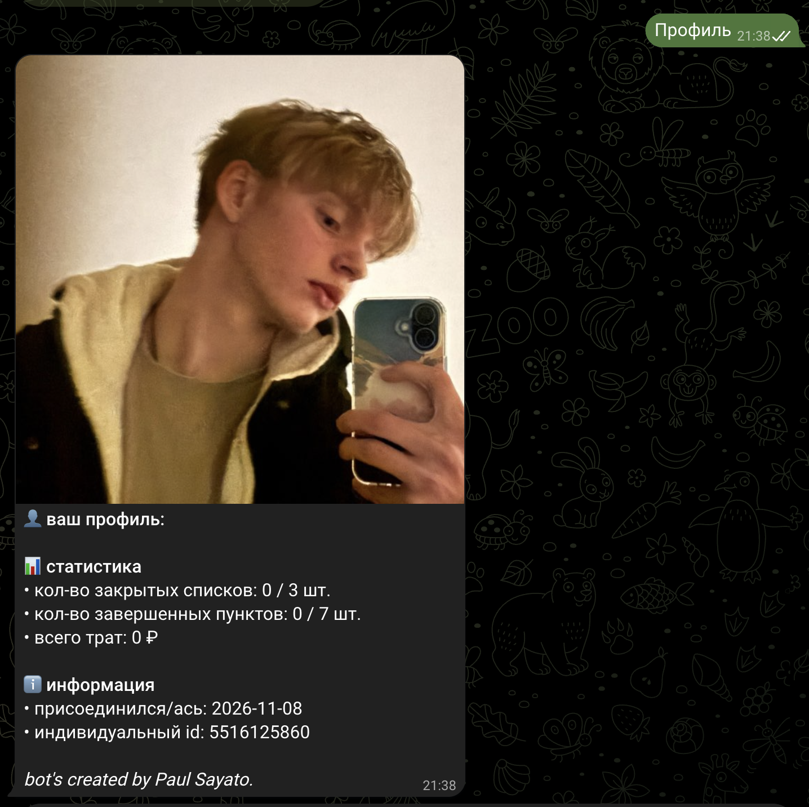

<h1 align="center">🛒 shopNote</h1>

<p align="center">
  
</p>

<p align="center">
  <i>телеграм-бот для быстрых списков покупок в магазин.</i><br>
  <i>без лишнего — зашёл, записал, пошёл.</i>
</p>

---

## 💡 Идея продукта

Когда человек идёт в магазин, писать в заметки телефона или лезть в избранное мессенджера — уже прошлое. Каммон, некоторые 40+ летние типы иногда рандомным контактам списки продуктов пишут.

**Продукт нацелен на:** походы в магазин за «спонтанными» покупками — продукты, мелкая бытовуха и прочее. Не цели в плане «комп купить» или подобного.

**Идея в простоте:** быстрый заход в бота → запись.

**В чём разница от заметок или избранного?**  
Статистика и оформление.

---

<h2 align="center">📱 Как выглядит бот</h2>

|:---:|:---:|
|  |  |
| **/start** — приветствие и меню | **история** — ✅ завершён, ⏳ в процессе |
|  |  |
| **открытый список** — вычеркнуть, редактировать, завершить | **профиль** — статистика: списки, пункты, траты |

---

## 🛠 Технологии

- **Python 3.13** — основной язык.
- **FastAPI** — бэкенд (API для работы с БД).
- **SQLite** — база данных (хранится в файле `database.db`).
- **aiogram 3** — библиотека для Telegram-бота.
- **requests** — для связи бота с бэкендом.

---

## 🏗 Архитектура

```
Бот (aiogram)  →  HTTP  →  Бэкенд (FastAPI)  →  SQLite
```

Бот **не трогает БД напрямую** — только через API. Это позволяет в будущем добавить веб-интерфейс, не переписывая логику.

### Структура проекта

```text
shopNote/
├── backend/
│   ├── main.py           # FastAPI, бэкенд
│   └── database.db       # создаётся автоматически
├── bot/
│   ├── bot.py            # aiogram-бот
│   └── config.py         # токен (не в git)
├── screenshots/          # скрины для README
├── requirements.txt
├── .gitignore
└── README.md
```

### База данных

Три связанные таблицы:
- **`users`** — `telegram_id`, `joined_at`
- **`lists`** — `id`, `user_id`, `name`, `created_at`, `status`, `total_cost`
- **`items`** — `id`, `list_id`, `name`, `is_bought`

---

## 🚀 Запуск

1. Установить зависимости:
   ```bash
   pip install -r requirements.txt
   ```

2. Создать `bot/config.py`:
   ```python
   TOKEN = "твой_токен_от_BotFather"
   ```

3. Запустить бэкенд (терминал 1):
   ```bash
   uvicorn main:app --reload
   ```

4. Запустить бота (терминал 2):
   ```bash
   python bot.py
   ```

---

## ⚠️ Известные недочёты (Known issues)

Проект — первый в портфолио. Здесь честно перечислено, что знаю и что буду улучшать:

- **Один `callback_handler` на все кнопки**. Первый проект и соответствующие ошибки в оформлении. Исправлюсь.
- **«Вычеркнуть всё» не тоггл** — просто ставит `is_bought = 1` (осознанно).
- **Чек — целое число рублей** — копейки не поддерживаются (для магазина не нужно).
- **Троттлинг** работает только для сообщений, не для inline-кнопок.

---

## ‼️ Важно

**Я писал код сам. В ручную.**  
Использование нейросетей было инструментом чтобы:
1) Искать ошибки
2) Построить road-map
3) Фиксировать продвижение производства

По тому, как код написан можно действительно понять, что писал человек

---

<i>bot's created by Paul Sayato.</i>
