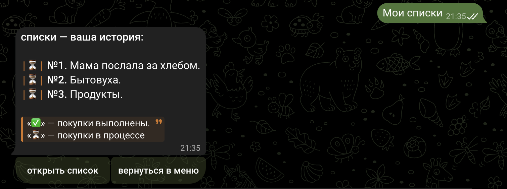

<h1 align="center">🛒 shopNote</h1>

<p align="center">
  
</p>

<p align="center">
  <i>телеграм-бот для быстрых списков покупок в магазин.</i><br>
  <i>без лишнего — зашёл, записал, пошёл.</i>
</p>

---

## 💡 Идея

shopNote помогает быстро записать покупки, вычёркивать их в магазине и смотреть историю. В профиле отображаются списки, покупки и траты.

## ✅ Что уже работает

- регистрация пользователя при первом `/start`;
- создание списка и добавление товаров;
- просмотр истории и открытие списка;
- отметка товара как купленного и снятие отметки;
- добавление и удаление товаров, удаление списка;
- завершение списка с сохранением суммы чека;
- профиль со статистикой;
- отдельный тестовый Telegram-бот для локальной разработки;
- первый успешный деплой бота в облако Amvera на бесплатном тарифе.

---

## 📱 Как выглядит бот

| | |
|:---:|:---:|
|  |  |
| **/start** — приветствие и меню | **история** — ✅ завершён, ⏳ в процессе |
|  |  |
| **открытый список** — вычеркнуть, редактировать, завершить | **профиль** — статистика: списки, пункты, траты |

---

## 🛠 Технологии

- **Python 3.13** — основной язык;
- **FastAPI** — бэкенд (API для работы с БД);
- **SQLite** — база данных;
- **aiogram 3** — библиотека для Telegram-бота;
- **requests** — для связи бота с бэкендом;
- **python-dotenv** — загрузка локальных настроек из `.env`.

---

## 🏗 Архитектура

```
Бот (aiogram)  →  HTTP  →  Бэкенд (FastAPI)  →  SQLite
```

Бот **не трогает БД напрямую** — только через API. Это позволяет в будущем добавить веб-интерфейс, не переписывая логику.

### Структура проекта

```text
ShopNote/
├── Backend/
│   ├── main.py
│   └── database.db       # локальная база, создаётся автоматически
├── Bot/
│   ├── bot.py
│   ├── config.py
│   └── shopNote.png
├── requirements.txt
├── .env                  # локальные настройки, не добавлять в Git
└── README.md
```

В SQLite три связанные таблицы: `users`, `lists` и `items`. Бот не подключается к базе напрямую: он отправляет запросы в FastAPI, а backend читает и изменяет SQLite.

---

## 🔁 Один код для локального запуска и облака

Для локальной работы и Amvera используется один и тот же Python-код. Отличаются только настройки, которые приложение получает при запуске. Поэтому при переходе на сервер не нужно вручную переписывать адреса в `bot.py`.

### Как выбирается адрес backend

В `Backend/main.py` и `Bot/config.py` используется `PROJECT_ROOT = Path(__file__).resolve().parents[1]`, чтобы найти корень проекта и загрузить оттуда локальный `.env`. Эти строки только находят файл с настройками. Они **не определяют**, где запущен проект, и не выбирают путь к базе.

Дальше `load_dotenv(...)` читает настройки из `.env`. Локально это файл в корне ShopNote. В Amvera локальный `.env` не нужен: приложение получает свои переменные из настроек окружения, и `load_dotenv` по умолчанию не перезаписывает уже заданные переменные.

В `Bot/config.py` из настроек читаются `TOKEN` и `API_URL`. Если локальный `API_URL` не задан, используется `http://127.0.0.1:8000`. Все запросы в `bot.py` используют эту переменную. Поэтому локальный бот обращается к backend на компьютере, а облачный — к адресу backend, заданному в Amvera. Сам Python-код запросов не меняется.

### Как выбирается база SQLite

В `Backend/main.py` переменная `DB_PATH` сначала ищет настройку `DATABASE_PATH`. Если её нет, используется файл `Backend/database.db` рядом с `main.py`.

Локально `DATABASE_PATH` можно не задавать — backend будет работать с локальным файлом. В Amvera для backend нужно задать `DATABASE_PATH=/data/database.db`. Папка `/data` — постоянное хранилище Amvera, поэтому база не должна пропасть при пересборке приложения.

### Где хранятся токены

Локальный `.env` содержит токен отдельного тестового бота. Прод-токен хранится в переменных окружения облачного приложения Amvera. `.env` исключён из Git и не должен загружаться в репозиторий.

Это важно: нельзя одновременно запускать локально и в облаке один и тот же Telegram-бот с long polling. Два процесса будут конкурировать за обновления. Для локальной разработки используется тестовый бот, а в облаке работает прод-бот.

Настройки для локального запуска в корневом `.env`:

```env
TOKEN=токен_тестового_бота
API_URL=http://127.0.0.1:8000
```

В облаке переменные задаются в настройках приложений Amvera: для бота — `TOKEN` и `API_URL`, для backend — `DATABASE_PATH`. Значения прод-токена в файлы проекта не записываются.

---

## 🚀 Локальный запуск

Запускать команды из корневой папки проекта. Если виртуальное окружение ещё не создано:

```bash
python3 -m venv .venv
source .venv/bin/activate
python -m pip install -r requirements.txt
```

Создай корневой `.env` с настройками тестового бота, как в примере выше.

Открой два терминала. В первом запусти backend:

```bash
source .venv/bin/activate
python -m uvicorn Backend.main:app --reload
```

Во втором запусти тестового бота:

```bash
source .venv/bin/activate
python Bot/bot.py
```

Сначала должен работать backend, затем бот. Когда пользователь нажимает кнопку в боте, бот отправляет HTTP-запрос на `API_URL`; backend выполняет операцию с `DB_PATH` и возвращает результат.

---

## ☁️ Деплой

Первый успешный деплой бота выполнен на Amvera. Облачное приложение запускается отдельно от локальной копии и продолжает работать, когда компьютер выключен.

Для облачной работы настройки задаются в Amvera, а не копируются из локального `.env`:

- бот получает прод-токен через `TOKEN` и адрес backend через `API_URL`;
- backend получает путь к постоянной SQLite-базе через `DATABASE_PATH=/data/database.db`;
- `requirements.txt` содержит зависимости проекта.

---

## 🧭 Что дальше

- пройти основные сценарии и отдельно проверить работу тестового бота локально;
- улучшить обработку сетевых ошибок и таймауты запросов;
- проверить, что секреты не попали в Git;
- подготовить скриншоты для портфолио.

---

## ‼️ Важно

**Я писал код сам. В ручную.**  
Использование нейросетей было инструментом чтобы:
1) Искать ошибки
2) Построить road-map
3) Фиксировать продвижение производства

По тому, как код написан можно действительно понять, что писал человек.

---

<i>bot's created by Paul Sayato.</i>